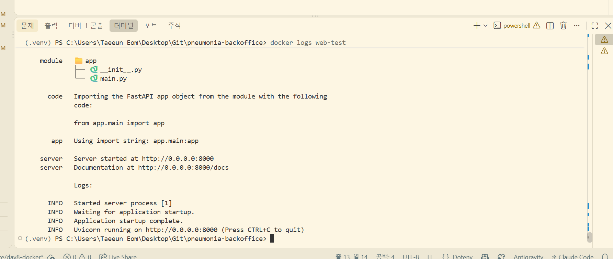
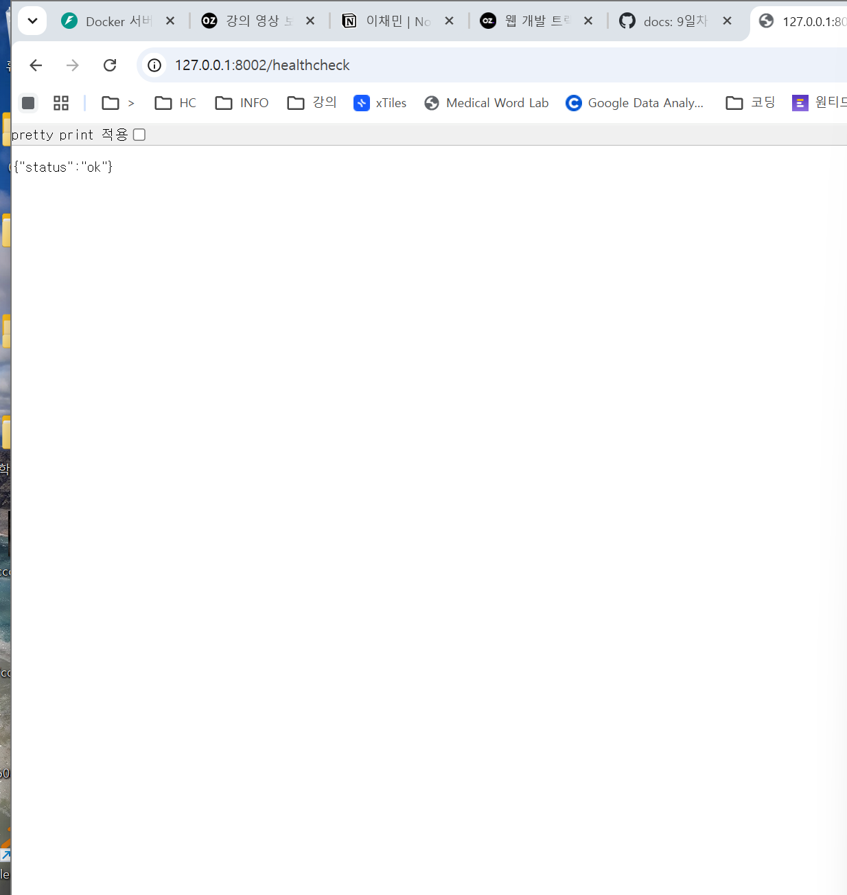
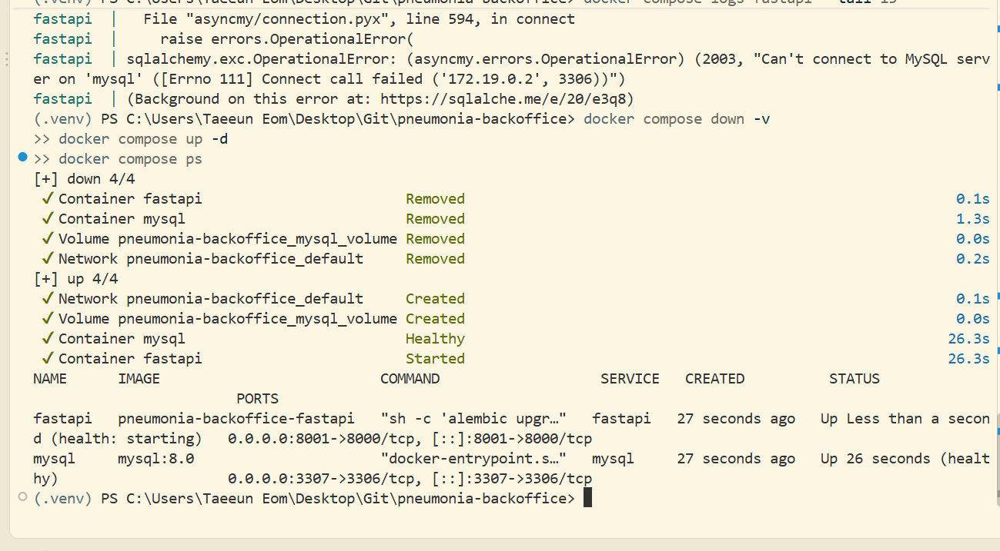
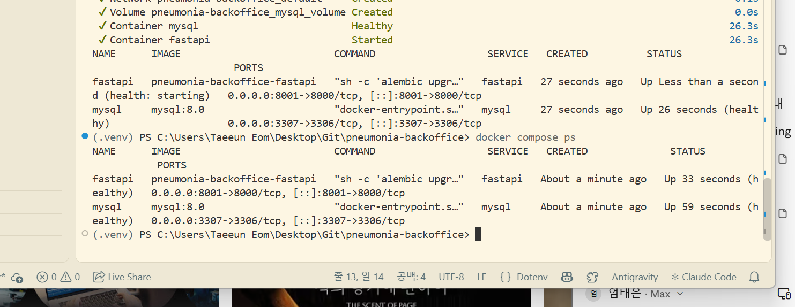

# 흉부 X-Ray 폐렴 판독 백오피스

흉부 X-Ray 폐렴 판독 AI 모델을 활용해 병원 의료진이 환자와 진료기록을 관리하고, X-Ray 이미지의 폐렴 여부를 예측해 보는 백오피스 웹 서비스입니다.

OZ코딩스쿨 AI 헬스케어 부트캠프 7기 PBL 과제로 4명이 함께 만들었습니다.

| 이름 | GitHub | 주 담당 |
|---|---|---|
| 엄태은 (팀장) | [ten-infosec](https://github.com/ten-infosec) | AI 모델 서빙(worker), 공통 기반 코드, 도커, Git 관리·리뷰 |
| 장성은 | [jsejj87](https://github.com/jsejj87) | DB 모델·마이그레이션, 회원가입·탈퇴, 환자 등록·삭제, AI 예측 API |
| 김민준 | [klas98765-pixel](https://github.com/klas98765-pixel) | 마이페이지 API 명세, AI 예측 결과 목록 API |
| 여현지 | [yeohj1226](https://github.com/yeohj1226) | 관리자 회원 관리, 환자 목록·상세·수정, 응답 스키마 |

---

## 주요 기능

| 구분 | 기능 |
|---|---|
| 회원 | 회원가입, 로그인(JWT 액세스 토큰 + HttpOnly 리프레시 토큰), 토큰 재발급, 로그아웃, 마이페이지(조회·수정·비밀번호 변경·탈퇴) |
| 관리자 | 회원 목록·검색, 권한 변경(대기자 → 스태프 승인) |
| 환자 | 환자 등록·목록·검색(이름·성별·나이)·상세·수정·삭제 |
| 진료기록 | 진료기록 등록(X-Ray 업로드), 목록·상세 |
| AI 예측 | ResNet18 모델로 폐렴 여부·확신도 예측, Grad-CAM 히트맵 생성, 같은 기록·모델 결과 재사용 |

## 기술 스택

| 구분 | 사용 기술 |
|---|---|
| Backend | FastAPI, Pydantic v2, SQLAlchemy 2.0 (async), Alembic |
| Database | MySQL 8.0 |
| AI | PyTorch, torchvision (ResNet18), Grad-CAM |
| 인증 | JWT (PyJWT), argon2 비밀번호 해싱 |
| Infra | Docker, Docker Compose, uv |
| 협업 | Git, GitHub (Git Flow 간소화), Notion |

---

## 실행 방법

### 1) 환경 변수

```powershell
copy .env.example .env
```

`.env`의 `SECRET_KEY`는 아래 명령으로 만든 값으로 바꿉니다. `.env`는 절대 커밋하지 않습니다.

```powershell
uv run python -c "import secrets; print(secrets.token_hex(32))"
```

### 2) Docker Compose로 실행 (권장)

```powershell
docker compose up -d --build
docker compose ps
docker compose logs -f fastapi
```

- `fastapi` 컨테이너가 시작될 때 `alembic upgrade head`로 테이블을 만든 뒤 `--reload` 모드로 서버를 켭니다.
- 브라우저에서 `http://127.0.0.1:8000` 으로 접속합니다. 8000번 포트를 다른 프로그램이 쓰고 있으면 `.env`에 `APP_PORT=8001`을 추가합니다.
- 컨테이너 MySQL은 내 컴퓨터의 `3307` 포트로 연결됩니다. 내 컴퓨터에 설치한 MySQL(3306)과 충돌하지 않습니다.
- 종료: `docker compose down` / DB 데이터까지 삭제: `docker compose down -v`

### 3) 로컬에서 직접 실행

```powershell
uv sync
uv run alembic upgrade head
uv run fastapi run app/main.py
```

---

## 프로젝트 구조

```
.
├── app/
│   ├── apis/          # 라우터 (요청·응답, 상태 코드)
│   ├── core/          # 설정, DB 연결, 인증 의존성, 보안, 파일 저장
│   ├── models/        # SQLAlchemy 모델 (users, patients, medical_records, xray_images, ai_analysis_results)
│   ├── repositories/  # DB 읽기·쓰기
│   ├── schemas/       # Pydantic 요청·응답 형식
│   ├── services/      # 비즈니스 로직
│   ├── main.py
│   ├── Dockerfile
│   └── Dockerfile.dockerignore
├── worker/
│   ├── model.py       # 모델 로드, 전처리, 예측, Grad-CAM 히트맵
│   ├── check_model.py # 서버 없이 모델 단독 확인
│   └── models/        # 학습한 가중치 (final_resnet18.pth)
├── alembic/           # DB 마이그레이션
├── static/            # 프론트엔드 템플릿
├── tests/
├── docs/              # 일차별 설계·명세 문서
├── docker-compose.yml
├── pyproject.toml
└── uv.lock
```

---

## 프로젝트 과정 총 정리

AI 웹 서비스를 만드는 과정을 10단계로 나누고, 단계마다 우리 팀이 어떻게 진행했는지와 다음 프로젝트에 가져갈 점을 정리했습니다.

| 단계 | 진행 일차 | 상태 | 산출물 |
|---|---|---|---|
| 1. Team Rule 정의 | 1일차 | 완료 | [`docs/1일차_team_rules.md`](docs/1일차_team_rules.md) |
| 2. 사용자 요구사항 정의 | 4~6일차 | 완료 (제공된 정의서 분석) | 각 API 명세의 요구사항 ID |
| 3. API 명세서 작성 | 4~6일차 | 완료 | [User](docs/4일차_USER_API_설계.md) · [환자·진료기록](docs/5일차_환자관리_API_설계.md) · [폐렴 예측](docs/6일차_폐렴예측_API_설계.md) |
| 4. Git & GitHub 브랜치 전략 | 2일차 | 완료 | [`docs/2일차_git_branch_전략.md`](docs/2일차_git_branch_전략.md) |
| 5. 프로젝트 세팅 | 3일차 | 완료 | [`docs/3일차_프로젝트_뜯어보기.md`](docs/3일차_프로젝트_뜯어보기.md), [`docs/3일차_db_migration.md`](docs/3일차_db_migration.md) |
| 6. API·AI 워커 코드 작성과 병합 | 2·4~7일차 | 완료 | PR #1~#56 |
| 7. 아키텍처 설계 및 적용 | 4~6일차, 9일차 | 레이어 구조 완료 / 워커 분리 설계 진행 | 3계층 구조, Redis 기반 AI 워커 분리 설계 |
| 8. 도커 인프라 파일 작성 | 8일차 | 완료 | `app/Dockerfile`, `app/Dockerfile.dockerignore`, `docker-compose.yml` |
| 9. AWS 배포 | 예정 | 준비 | EC2 + Docker Compose + Nginx 배포 계획 |
| 10. QA 진행 | 7일차 | 화면 QA 완료 / 배포 후 QA 예정 | [`docs/7일차_앱_실행화면.md`](docs/7일차_앱_실행화면.md) |

### 1. Team Rule 정의

**어떻게 진행했나**
- 첫날 코어 타임(매일 15:10~16:00, 카메라 ON), 호칭("oo님"과 존댓말), 막히면 30분 안에 공유하기 같은 운영 규칙을 정했습니다.
- 역할은 "주 담당"으로만 나누고, 모든 Stage에서 **한 사람당 최소 1개 이상 커밋·PR**을 남기기로 했습니다.
- Stage마다 팀장이 "조립 설명서"(할 일, 담당 구역, 캡처 목록, 설명할 수 있어야 하는 것)를 만들어 공유하고, 각자 맡은 구역을 채우는 방식으로 진행했습니다.

**다음 프로젝트에 가져갈 점**
- 결석·환경 문제로 한 사람이 빠질 때 대신 맡을 사람을 미리 정해 두면 좋겠습니다. 7일차에 장성은님이 결석한 팀원 섹션을 대신 작성한 경험에서 배운 점입니다.

### 2. 사용자 요구사항 정의

**어떻게 진행했나**
- 이번에는 요구사항 정의서가 제공되어, 정의서의 요구사항 ID(`REQ-USER-001`, `REQ-PRED-001` 등)를 API 명세서마다 연결해 "이 API가 어떤 요구사항을 만족하는지"를 추적했습니다.
- 비기능 요구사항도 코드로 옮겼습니다. 예를 들어 액세스 토큰 30분·리프레시 토큰 7일(`NFR-USER-001`), 예측 응답 3초 이내, 모델 Recall 0.90 이상이 있습니다.

**다음 프로젝트에 가져갈 점**
- 파이널 프로젝트에서는 정의서를 직접 써야 합니다. 이번에 읽어 본 형식(ID, 기능 설명, 권한, 우선순위, 비기능 요구사항)을 그대로 템플릿으로 사용할 예정입니다.

### 3. API 명세서 작성

**어떻게 진행했나**
- 명세서 공통 규칙(기본 주소 `/api/v1`, 인증 방식, 에러 응답 형식, 비밀번호·전화번호 규칙)을 먼저 정한 뒤, API마다 개요·요청·응답·실패 케이스를 같은 형식으로 나눠 작성했습니다.
- **프론트 템플릿(`static/apis.js`)이 실제로 부르는 주소와 필드 이름에 맞춰** 명세를 고쳤습니다. 그 덕분에 7일차 화면 연결에서 20개 호출이 모두 수정 없이 동작했습니다.

**다음 프로젝트에 가져갈 점**
- 명세서를 먼저 확정하고 코드를 짜야 팀원끼리 함수 이름·반환 형식을 다시 맞추는 일이 줄어듭니다. 6일차에는 "팀 약속"(함수 이름, 반환 형식)을 먼저 정해 동시에 개발할 수 있었습니다.

### 4. Git & GitHub 브랜치 전략 구성

**어떻게 진행했나**
- Git Flow를 우리 팀 규모에 맞게 줄여서 사용했습니다.

```
feature/* · fix/* ──PR(승인 1명)──▶ develop ──PR──▶ main
docs/*  ─────────────PR───────────────────────────▶ main
                             main ──동기화 PR──▶ develop
```

- 코드는 `develop`에 PR로 모으고(승인 1명 필수), 문서는 `main`에 바로 PR로 올렸습니다. 일정 단위로 develop → main 병합 후 main → develop 동기화를 했습니다.
- 병합은 "Create a merge commit"으로 통일해 PR 단위 기록이 남도록 했습니다.
- 커밋 메시지는 `feat:`, `fix:`, `docs:`, `chore:` 머리말을 사용했습니다.

**다음 프로젝트에 가져갈 점**
- PR의 base 브랜치를 잘못 고르는 실수가 몇 번 있었습니다(코드 PR을 main으로 올림). PR 템플릿에 "base 확인" 체크 항목을 넣을 예정입니다.
- 같은 파일을 여러 명이 고칠 때는 담당 구역을 주석으로 나눈 "뼈대"를 먼저 병합하면 충돌이 거의 없었습니다.

### 5. 프로젝트 세팅

**어떻게 진행했나**
- 제공된 템플릿 구조(`app/apis`, `core`, `models`, `repositories`, `schemas`, `services`)를 폴더별로 나눠 분석하고 문서로 남겼습니다.
- `uv`로 의존성을 관리하고 `uv.lock`을 커밋해 팀원 모두 같은 버전을 쓰도록 했습니다.
- ERD를 보고 SQLAlchemy 모델 5개를 작성한 뒤 Alembic으로 마이그레이션을 만들어 MySQL에 테이블을 생성했습니다.
- `.env`(DB 비밀번호, `SECRET_KEY`)와 `media/`(환자 X-Ray)는 `.gitignore`에 넣어 저장소에 올리지 않았습니다.

**다음 프로젝트에 가져갈 점**
- DB 비밀번호에 특수문자가 있으면 접속 URL이 깨지는 문제가 있었습니다(#18에서 URL 인코딩으로 해결). 환경 변수는 처음부터 인코딩을 고려하겠습니다.
- 팀원마다 로컬 MySQL 설정이 달라 DB 연결 문제가 반복됐습니다. 8일차에 Docker Compose로 DB까지 컨테이너로 띄우면서 해결했고, 다음에는 첫날부터 컨테이너로 시작하겠습니다.

### 6. API 및 AI 워커 코드 작성 후 브랜치 전략을 통한 코드 병합

**어떻게 진행했나**
- 공통 기반(설정, DB 세션, 인증 의존성, 예외 처리, 파일 저장)을 먼저 PR로 병합한 뒤, 기능별로 나눠 동시에 개발했습니다.

| 일차 | 주요 PR | 내용 |
|---|---|---|
| 2일차 | #1~#4 | 실습용 CRUD API로 PR·리뷰 흐름 연습 |
| 3일차 | #10 | DB 모델 5개 + 마이그레이션 |
| 4일차 | #13, #18, #20, #21, #23, #25 | User API (인증, 회원가입·탈퇴, 관리자, 프론트 연동) |
| 5일차 | #30, #32, #33 | 환자·진료기록 API (X-Ray 업로드 포함) |
| 6일차 | #37, #38, #43, #44, #45 | AI 모델 서빙(worker), 예측 API, 결과 목록 API |
| 7일차 | #52 | 화면 테스트 중 발견한 비밀번호 알림 버그 수정 |

- AI 워커(`worker/model.py`)는 서버 시작 시 모델을 한 번만 메모리에 올리고, 학습 때와 같은 전처리를 적용하며, 가중치만 불러오는 안전한 로딩(`weights_only=True`)을 사용했습니다.
- 병합 전에는 PR 브랜치를 develop에 미리 합쳐 보고, 테스트(SQLite 메모리 DB)로 확인한 뒤 병합했습니다.

**다음 프로젝트에 가져갈 점**
- 기능 PR과 문서 PR을 분리하니 리뷰가 쉬웠습니다. 다음에는 PR마다 테스트 결과(또는 Swagger 캡처)를 첨부하는 규칙을 추가하겠습니다.

### 7. 아키텍처 설계 및 적용

**어떻게 진행했나**
- **계층 구조**: `apis`(요청·응답) → `services`(비즈니스 로직) → `repositories`(DB 접근)로 역할을 나눴습니다. 권한 확인은 `core/dependencies.py`의 의존성(`CurrentStaff`, `CurrentAdmin`, `CurrentMedicalStaff`)으로 통일했습니다.
- **AI 추론 분리 설계 (9일차)**: 지금은 예측이 FastAPI 프로세스 안에서 실행되어, 요청이 몰리면 다른 API까지 느려지고 같은 요청이 동시에 두 번 처리될 수 있습니다. 이를 해결하기 위해 FastAPI는 Redis 작업 큐에 작업을 넣고, 별도 AI 워커 컨테이너가 꺼내 예측한 뒤 Pub/Sub으로 결과를 돌려주는 구조를 설계했습니다.

**다음 프로젝트에 가져갈 점**
- 무거운 작업(AI 추론)은 처음부터 웹 서버와 분리된 워커로 설계하겠습니다.

### 8. 도커 인프라 관련 파일 작성

**어떻게 진행했나**
- `app/Dockerfile`: `python:3.13-slim` + `uv`로 `uv.lock`에 고정된 버전을 설치합니다. 의존성 설치를 소스 복사보다 먼저 해서, 코드만 바뀌면 빌드 캐시를 재사용합니다. 운영용 실행 명령은 `fastapi run`(reload 없음)이고, 개발할 때는 compose가 `--reload`로 덮어씁니다.
- `app/Dockerfile.dockerignore`: `.env`, 파이썬·라이브러리 캐시, 가상환경, 도커 설정 파일, `docs/`, `README.md`, IDE 설정, `media/`(환자 X-Ray)를 이미지에서 뺐습니다.
  - 빌드 컨텍스트가 프로젝트 루트이고 Dockerfile이 `app/`에 있어서, `app/.dockerignore`는 도커가 읽지 않습니다. 직접 빌드해 확인한 뒤 Dockerfile 옆에 두는 규칙(`<Dockerfile 이름>.dockerignore`)에 맞춰 이름을 정했습니다.
- `docker-compose.yml`: `fastapi`와 `mysql` 서비스를 정의했습니다.
  - 프로젝트 폴더를 `/app`에 마운트하고 `--reload`로 실행해, 코드를 고치면 바로 반영됩니다.
  - 가상환경은 `/opt/venv`에 만들어 마운트에 가려지지 않게 했습니다.
  - MySQL이 healthy 상태가 된 뒤 FastAPI가 시작되고, 시작할 때 `alembic upgrade head`로 테이블을 만듭니다.
- 리눅스 컨테이너에서는 PyTorch CPU 전용 패키지를 받도록 `pyproject.toml`에 설정해, GPU 라이브러리(수 GB)가 이미지에 들어가지 않게 했습니다.

**실행 화면**

| Dockerfile 단독 실행 | `/healthcheck` 응답 |
|---|---|
|  |  |

| `docker compose up -d` | `docker compose ps` (fastapi·mysql healthy) |
|---|---|
|  |  |

**실행하면서 만난 문제와 해결**

| 문제 | 원인 | 해결 |
|---|---|---|
| 빌드 중 `rpc error: EOF`로 Docker Desktop 엔진이 멈춤 | PyTorch 등 큰 패키지를 동시에 풀면서 노트북 Docker Desktop의 메모리 부족 | `UV_CONCURRENT_INSTALLS=1`로 하나씩 설치, 바이트코드 미리 컴파일 제외 → 이미지도 3.2GB → 1.6GB로 감소 |
| `'latin-1' codec can't encode` | `.env` 비밀번호 칸에 한글이 들어감 | `.env` 값 수정 (MySQL 접속 비밀번호는 영문·숫자·기호만) |
| `Access denied for user` | VS Code 터미널에 예전 `.env` 값이 환경 변수로 남아, compose가 그 값으로 MySQL 계정을 만듦 | 터미널 환경 변수 삭제 후 `docker compose down -v`로 DB 볼륨 재생성 |
| `Can't connect to MySQL server` | MySQL이 초기화용 임시 서버를 켠 상태에서 healthcheck가 통과해 fastapi가 너무 일찍 접속 | healthcheck를 `mysqladmin ping -h 127.0.0.1`(TCP)로 바꾸고 fastapi에 `restart: on-failure` 추가 |

**다음 프로젝트에 가져갈 점**
- AI 워커 분리 후에는 FastAPI 이미지에서 PyTorch를 빼고, 워커 이미지에만 넣어 이미지 크기를 줄일 예정입니다.

### 9. AWS 배포

**계획**
- EC2(t3.micro, Ubuntu)에 Docker Engine·Compose를 설치하고, 메모리가 부족하므로 스왑 메모리 2GB를 설정합니다.
- 로컬에서 이미지를 빌드해 Docker Hub에 푸시하고, EC2에서는 `docker-compose.prod.yml`로 이미지를 받아 실행합니다.
- Nginx를 앞에 두어 정적 파일(`static`, `media`)은 Nginx가 직접 주고, API 요청만 FastAPI로 전달합니다.
- 보안 그룹의 SSH는 내 IP만 허용하고, `.pem` 키와 `.prod.env`는 저장소에 올리지 않습니다. 과제가 끝나면 EC2 등 사용한 리소스를 모두 정리합니다.

### 10. QA 진행

**어떻게 진행했나**
- 7일차에 `fastapi run`으로 서버를 띄우고, 화면 20개 API 호출을 모두 직접 눌러 확인했습니다. 결과는 화면별 캡처와 함께 [`docs/7일차_앱_실행화면.md`](docs/7일차_앱_실행화면.md)에 정리했습니다.
- 테스트 중 "현재 비밀번호를 틀렸는데 비밀번호 규칙 문장이 뜨는" 버그를 개발자 도구 Network 탭으로 찾아냈습니다. 명세(규칙 위반 422 / 비밀번호 불일치 400)와 대조해 원인을 찾고 #52로 고쳤습니다.
- 토큰 재발급은 액세스 토큰을 일부러 망가뜨려 401 → refresh → 재요청 흐름을 확인했습니다.
- 권한 테스트(개발팀 계정으로 환자 등록 시 403)와 예외 케이스(비밀번호 규칙 위반 안내)도 함께 확인했습니다.

**다음 프로젝트에 가져갈 점**
- 배포 후 QA를 위해 기능별 체크리스트(정상·실패·권한 케이스)를 문서로 만들고, 배포 서버에서 같은 체크리스트로 다시 확인하겠습니다.

---

## Alembic Migration Guide

모델(`app/models/`)이 바뀌면 마이그레이션 파일을 만들고 DB에 반영합니다.

```bash
# 1. 마이그레이션 파일 생성
uv run alembic revision --autogenerate -m "변경 내용 설명"

# 2. 데이터베이스에 반영
uv run alembic upgrade head

# 3. 마지막 마이그레이션 취소
uv run alembic downgrade -1
```
