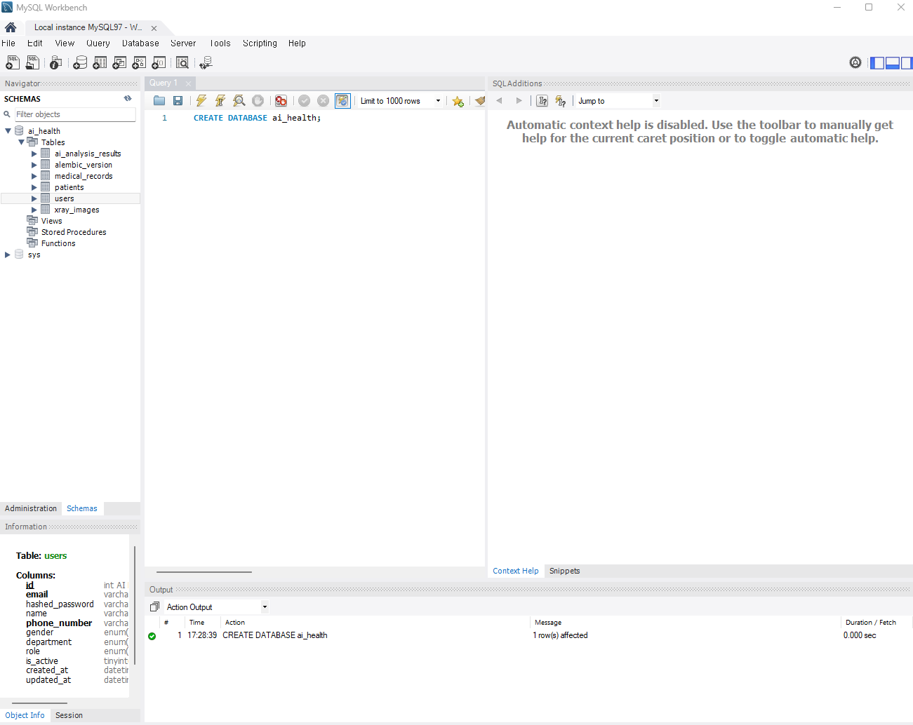
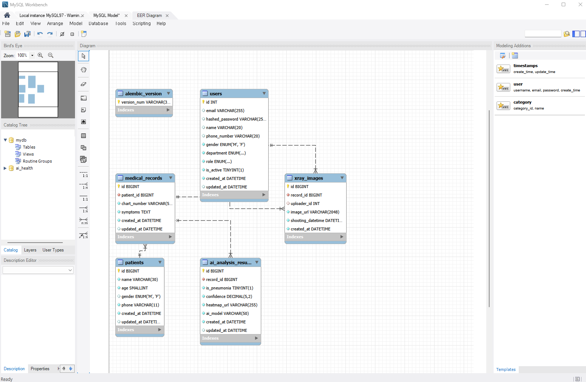

# 3일차 DB 모델 작성 및 마이그레이션

## 작업 내용
- ERD를 보고 SQLAlchemy로 모델 5개 작성 (`app/models/`)
  - users, patients, medical_records, xray_images, ai_analysis_results
- alembic으로 마이그레이션 파일 만들고 MySQL에 테이블 생성

## 사용한 DB
- 로컬 MySQL (DB 이름: `ai_health`)

## 실행한 명령어
```powershell
python -m uv run alembic revision --autogenerate -m "create tables"
python -m uv run alembic upgrade head
```

## DB Viewer 확인 (MySQL Workbench)

### 테이블 목록


### ERD
