# 7일차 앱 실행 화면

> 과제: 프론트 템플릿 코드(`static/`)에 API를 연결하고, `fastapi run app/main.py`로 실행한 화면을 endpoint별로 정리한다.
>
> 팀원별 담당
> - 엄태은: 실행 방법, API 연결 구조, 토큰 재발급, 진료기록 목록·상세, AI 예측
> - 김민준: 회원가입, 로그인, 로그아웃, 마이페이지(조회·수정·비밀번호 변경·탈퇴)
> - 장성은: 환자 등록·삭제, 진료기록 등록
> - 여현지: 환자 목록·상세·수정, 관리자 회원 관리
>
> 캡처 규칙: 테스트 계정·공개 샘플 X-ray만 사용, 토큰·비밀번호가 보이면 가리기. 이미지는 `docs/images/day7/` 에 `번호_기능.png` 이름으로 저장.

---

## 0. 실행 방법과 화면 ↔ API 대응 (담당: 엄태은)

### 0-1. 실행

```powershell
git switch develop
git pull origin develop
uv sync
fastapi run app/main.py
```

- 브라우저에서 `http://127.0.0.1:8000/` 으로 접속한다. (Windows에서는 `0.0.0.0` 대신 `127.0.0.1`)
- 다른 프로그램이 8000번 포트를 쓰고 있으면 `fastapi run app/main.py --port 8001` 로 실행하고 `http://127.0.0.1:8001/` 로 접속한다.

### 0-2. 화면이 API를 부르는 방식

화면(`static/*.html`)은 직접 `fetch`하지 않고, 모두 `static/apis.js`의 `apis.request()`를 거쳐 API를 부른다.

| 단계 | 하는 일 | 코드 위치 |
|---|---|---|
| ① 주소 만들기 | `API_BASE`(`/api/v1`) + 각 기능 주소. 상대 주소라서 8000·8001 어느 포트로 실행해도 그대로 동작 | `apis.js` 6행 |
| ② 토큰 첨부 | 로그인 때 받은 액세스 토큰을 `Authorization: Bearer <토큰>` 헤더에 자동으로 붙임 | `apis.js` 23~25행 |
| ③ 401 처리 | 토큰이 만료·위조되어 401이 오면 `POST /users/refresh`(쿠키의 리프레시 토큰)로 새 토큰을 받아 원래 요청을 다시 보냄. 재발급도 실패하면 로그아웃 | `apis.js` 31~82행 |
| ④ 에러 표시 | 응답이 실패면 `detail` 문구를 알림창으로 보여 줌. 422(입력값 오류)처럼 배열이면 `msg`만 모아서 보여 줌 | `apis.js` 85~100행 |

→ 화면 쪽은 "어떤 주소를 어떤 값으로 부를지"만 정하고, 토큰·재발급·에러 처리는 `apis.request()` 한 곳에서 공통으로 처리한다.

### 0-3. 화면 ↔ API 대응표

| # | 화면 | 동작 | 메서드·주소 | 담당 |
|---|---|---|---|---|
| 1 | 회원가입 | 가입 버튼 | `POST /api/v1/users/signup` | 김민준 |
| 2 | 로그인 | 로그인 버튼 → 내 정보 | `POST /api/v1/users/login`, `GET /api/v1/users/me` | 김민준 |
| 3 | (자동) | 토큰 만료 시 재발급 | `POST /api/v1/users/refresh` | 엄태은 |
| 4 | 상단 메뉴 | 로그아웃 | `POST /api/v1/users/logout` | 김민준 |
| 5 | 마이페이지 | 정보 수정 / 비밀번호 변경 / 탈퇴 | `PATCH /users/me`, `PATCH /users/me/password`, `DELETE /users/me` | 김민준 |
| 6 | 회원 관리(관리자) | 목록·검색 / 권한 변경 | `GET /api/v1/admin/users`, `PATCH /api/v1/admin/users/role` | 여현지 |
| 7 | 환자 등록 | 등록 버튼 | `POST /api/v1/patients` | 장성은 |
| 8 | 환자 목록 | 목록·검색 | `GET /api/v1/patients` | 여현지 |
| 9 | 환자 상세 | 상세보기 / 정보 수정 | `GET /api/v1/patients/{id}`, `PATCH /api/v1/patients/{id}` | 여현지 |
| 10 | 환자 상세 | 삭제 | `DELETE /api/v1/patients/{id}` | 장성은 |
| 11 | 진료기록 등록 | 등록 버튼 (X-ray 업로드) | `POST /api/v1/medical-records` | 장성은 |
| 12 | 환자 상세 | 진료기록 목록 | `GET /api/v1/patients/{id}/medical-records` | 엄태은 |
| 13 | 진료기록 상세 | 상세 / AI 예측 결과보기 / 예측 결과 목록 | `GET /medical-records/{id}`, `POST …/predict`, `GET …/analyses` | 엄태은 |

---

## 1. 회원가입 (담당: 김민준)

- API: `POST /api/v1/users/signup`
- 화면에서 이메일, 이름, 부서, 성별, 전화번호, 비밀번호를 입력하고 가입하기를 누르면 서버로 보낸다.
- 가입이 끝나면 "회원가입이 완료되었습니다. 로그인해주세요." 알림과 함께 로그인 화면으로 이동한다.
- 가입 직후 권한은 대기자(`pending`)다.
- 비밀번호가 규칙(대소문자, 특수문자, 숫자 포함 8자 이상)에 맞지 않으면 가입되지 않고 안내 알림이 뜬다.

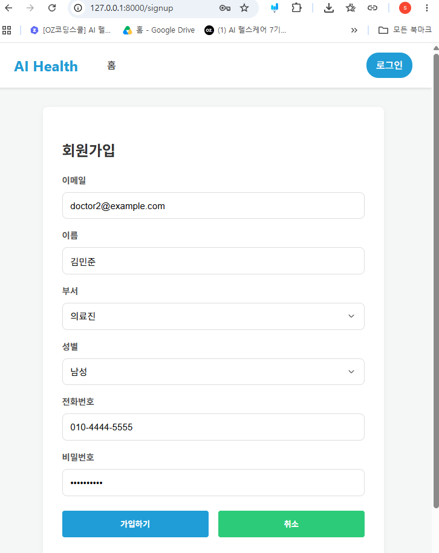

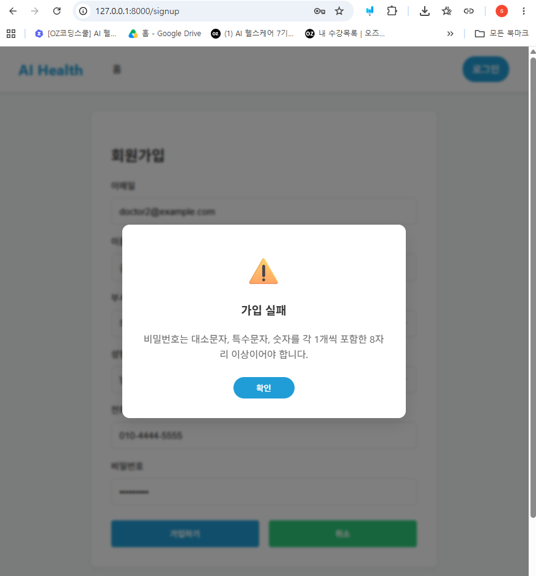

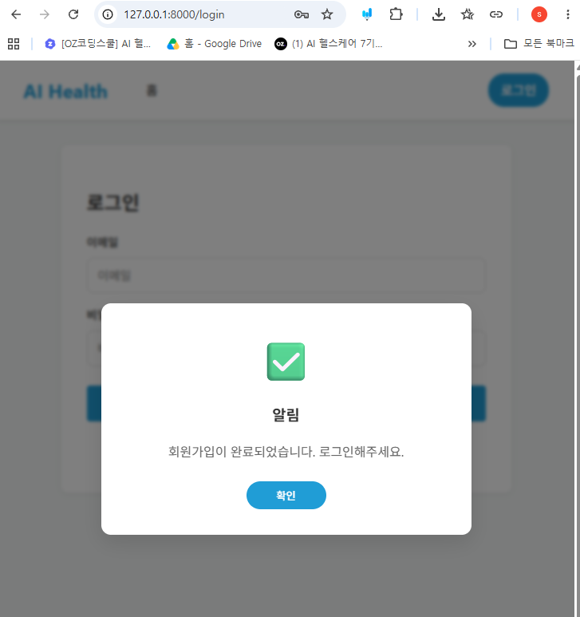

## 2. 로그인 · 로그아웃 (담당: 김민준)

### 2-1. 로그인

- API: `POST /api/v1/users/login` (폼: username, password) → `GET /api/v1/users/me`
- 로그인에 성공하면 받은 토큰을 저장하고, 내 정보를 불러와 상단에 이름(부서)을 표시한다.
- 대기자(`pending`)는 홈 화면으로 이동하고 "관리자의 승인을 기다리는 중입니다." 문구가 보인다.
- 승인된 계정(`staff`)은 환자 목록 화면으로 바로 이동한다.

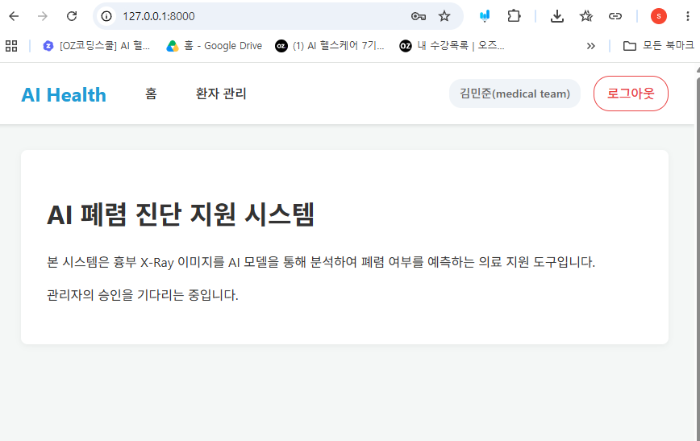

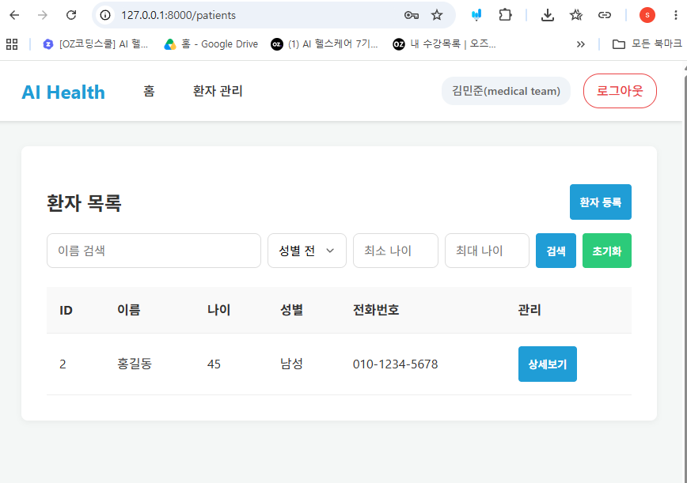

### 2-2. 로그아웃

- API: `POST /api/v1/users/logout`
- 상단의 로그아웃 버튼을 누르면 리프레시 토큰 쿠키가 지워지고 로그인 화면으로 이동한다.
- 로그아웃 상태에서 환자 목록 주소(`/patients`)로 들어가면 로그인 화면으로 돌아간다.

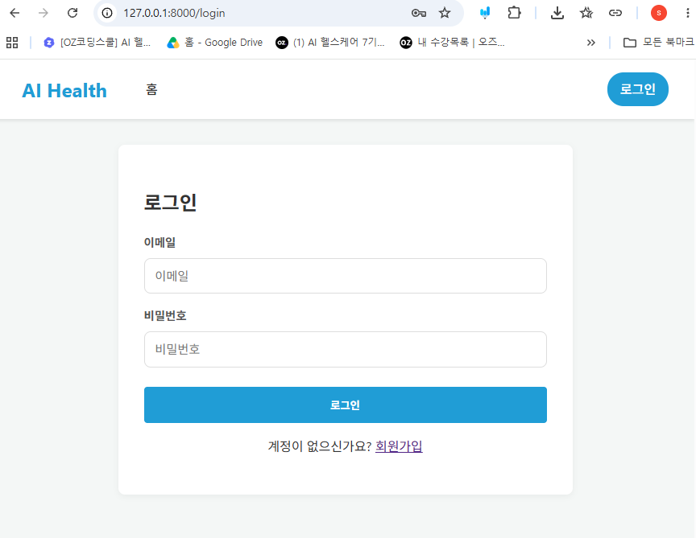

## 3. 토큰 재발급 (담당: 엄태은)

- API: `POST /api/v1/users/refresh` (화면에서 직접 누르는 버튼 없이 `apis.js`가 자동 호출)
- 확인 방법: 개발자 도구(F12) → Application → Local Storage의 `token` 값 끝에 문자를 붙여 일부러 망가뜨린 뒤, Network 탭(Fetch/XHR)에서 새로고침


| 순서 | 요청 | 상태 | 의미 |
|---|---|---|---|
| 1 | `me` | **401** | 망가진 액세스 토큰이라 서버가 거절 |
| 2 | `refresh` | **200** | HttpOnly 쿠키의 리프레시 토큰(7일)으로 새 액세스 토큰(30분) 발급 |
| 3 | `me` | 200 | 새 토큰으로 원래 요청을 다시 보내 성공 |
| 4 | `1`, `analyses` | 200 | 이어서 진료기록 상세·예측 결과 목록도 새 토큰으로 정상 조회 |

→ 사용자는 30분마다 다시 로그인할 필요 없이, 액세스 토큰이 만료되면 화면이 알아서 재발급받아 하던 작업을 이어 간다.

## 4. 마이페이지 (담당: 김민준)

### 4-1. 조회

- API: `GET /api/v1/users/me`
- 이메일, 이름, 부서, 성별, 전화번호, 권한을 보여 준다.

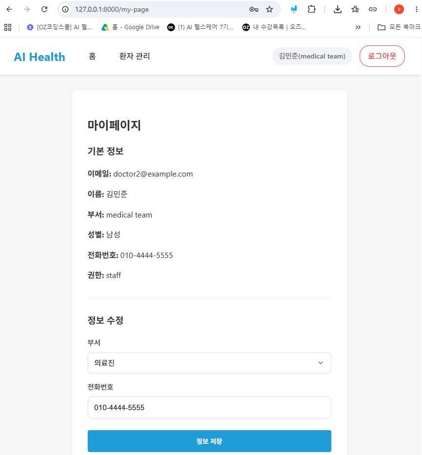

### 4-2. 정보 수정

- API: `PATCH /api/v1/users/me` (부서, 전화번호)
- 전화번호를 바꾸고 정보 저장을 누르면 "회원 정보가 수정되었습니다." 알림이 뜨고, 위쪽 기본 정보에 바로 반영된다.

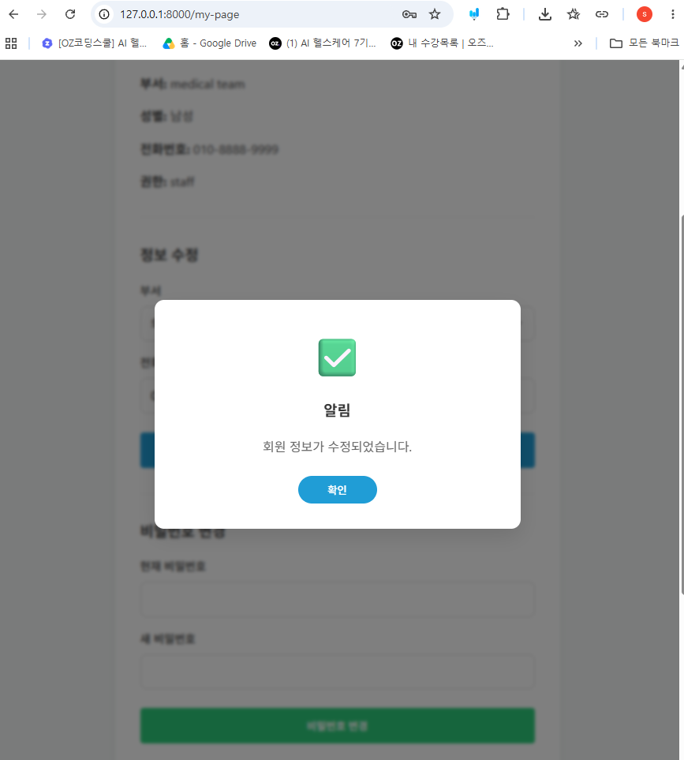

### 4-3. 비밀번호 변경

- API: `PATCH /api/v1/users/me/password`
- 현재 비밀번호와 새 비밀번호를 넣고 변경하면 "비밀번호가 변경되었습니다." 알림이 뜬다.
- 현재 비밀번호가 틀리면 서버가 400과 "현재 비밀번호가 일치하지 않습니다."를 돌려주고, 화면 알림에도 그 문장이 그대로 뜬다.
- 처음에는 화면(`static/pages.js`)이 400 응답도 비밀번호 규칙 문장으로 바꿔서 보여주는 문제가 있었다. 형식 오류(422)일 때만 규칙 문장을 보여주도록 고쳐서 해결했다. (#52)

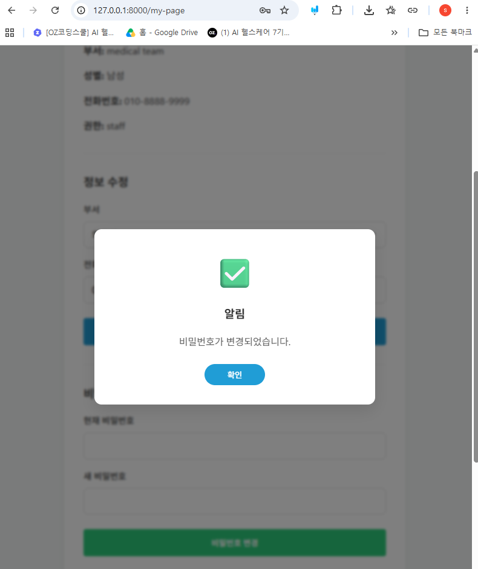

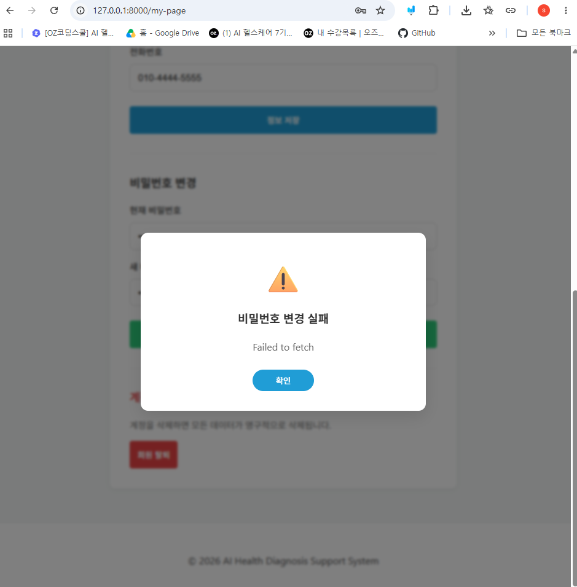

### 4-4. 회원 탈퇴

- API: `DELETE /api/v1/users/me`
- 탈퇴 버튼을 누르면 확인창이 뜨고, 확인을 누르면 계정이 삭제되고 로그인 화면으로 이동한다.
- 테스트용 계정으로만 진행했다.

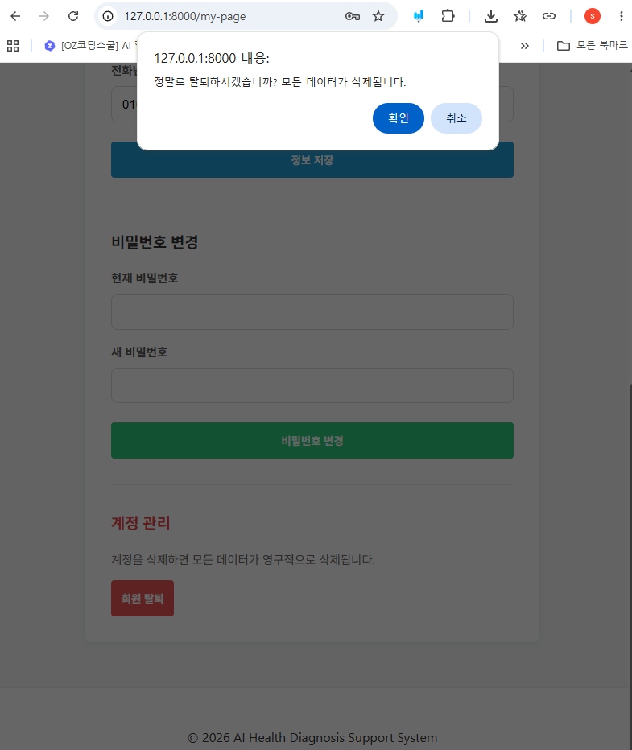

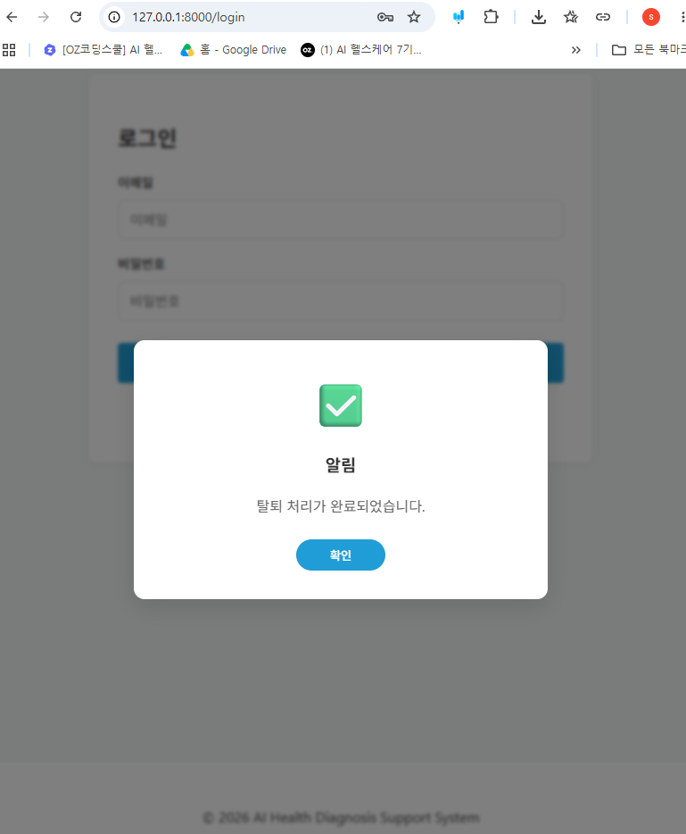

## 5. 회원 관리 (관리자, 담당: 여현지)

- 화면: admin_users, "회원 관리 (관리자 전용)"
- API: GET /api/v1/admin/users
- 캡처: 관리자 로그인 후 회원 목록 화면
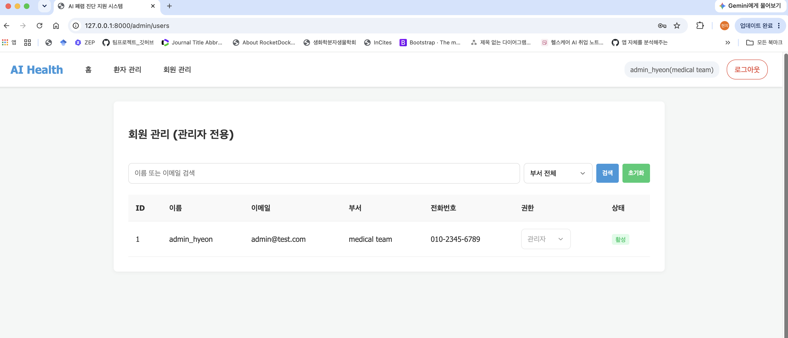
- 회원 권한 변경
    1. 변경 전 목록 화면: 회원(이은학)의 권한이 "승인대기"로 표시됨 
    2. 권한 변경 성공 알림: "권한이 변경되었습니다." 알림 창 
    3. 변경 후 목록 화면: 같은 회원의 권한이 "일반회원"으로 바뀜 
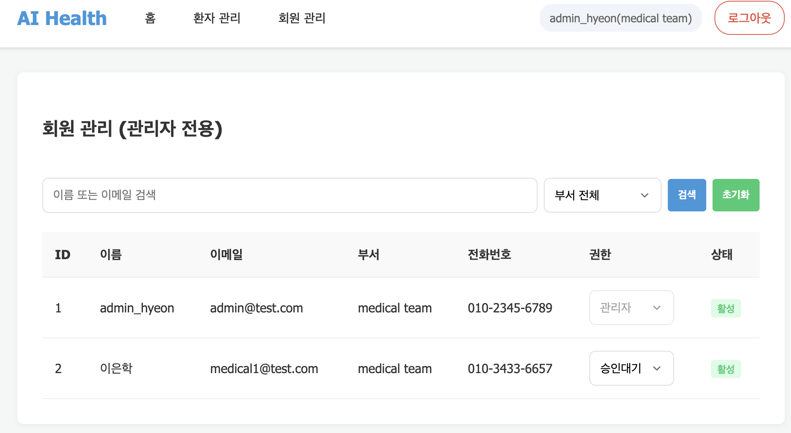
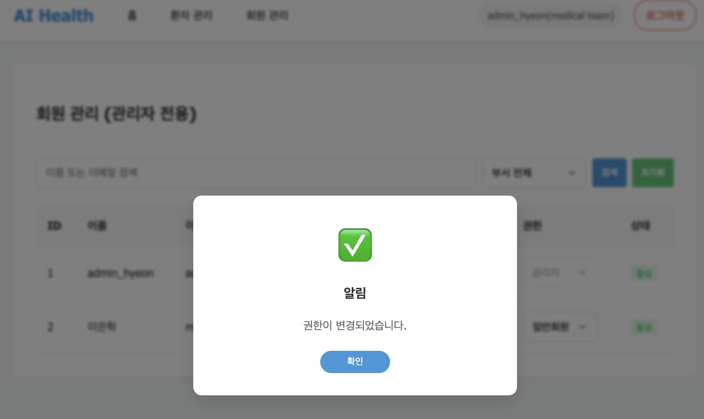


## 6. 환자 등록 · 삭제 (담당: 장성은)

### 6-1. 환자 등록

- API: `POST /api/v1/patients` (의료인만: medical team + staff 이상, 또는 admin)
- 화면에서 이름, 나이, 전화번호, 성별을 입력하고 등록 버튼을 누르면 서버로 보낸다.
- 등록이 끝나면 환자 목록으로 이동하고, 새 환자가 맨 위에 보인다.
- DB에는 성별 `M`, 연락처 `01098765432`로 저장되지만 화면에는 `남성`, `010-9876-5432`로 바꿔서 보여 준다.


### 6-2. 의료인이 아닌 계정의 등록 시도

- 개발팀 staff 계정(`developer`)으로 등록을 누르면 서버가 403을 돌려주고, 화면에 "접근 권한이 없습니다." 알림이 뜬다.


### 6-3. 환자 삭제

- API: `DELETE /api/v1/patients/{id}` (staff 이상)
- 환자 상세 화면에서 삭제 버튼을 누르면 확인 팝업이 뜨고, "확인했습니다."를 누르면 삭제된다.
- 환자를 지우면 그 환자의 진료기록과 X-ray 기록도 DB에서 같이 지워지고, 서버에 저장된 X-ray 이미지 파일도 삭제된다.
- 삭제 후 환자 목록으로 돌아가고, 지운 환자는 목록에서 사라진다.


## 7. 환자 목록 · 상세 · 수정 (담당: 여현지)

- API: GET /api/v1/patients/{id} 
- 수정: PATCH /api/v1/patients/{id} (이름·연락처)
- 설명: 진입 시 전체 환자를 한 번에 표시(페이지네이션 없음, ID 내림차순). 표시 값은 ID, 이름, 나이, 성별, 전화번호이며, 각 행의 "상세보기" 버튼으로 환자 상세 화면(9번)으로 이동. 우측 상단 "환자 등록" 버튼으로 환자 등록 화면으로 이동.
- 환자 목록 조회, 나이 및 성별 검색
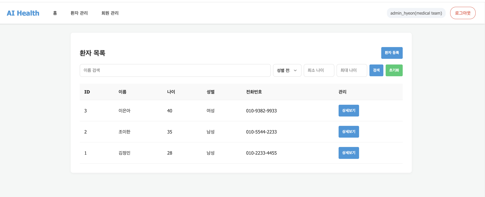
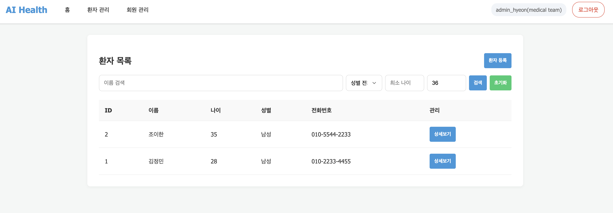
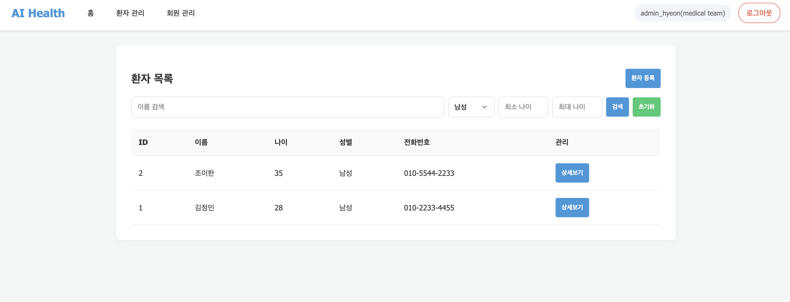
- 환자 상세 정보 수정
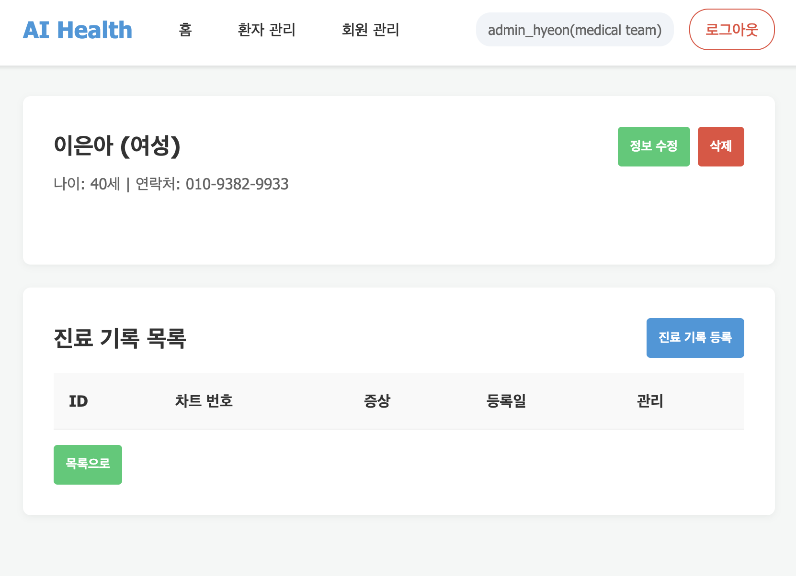
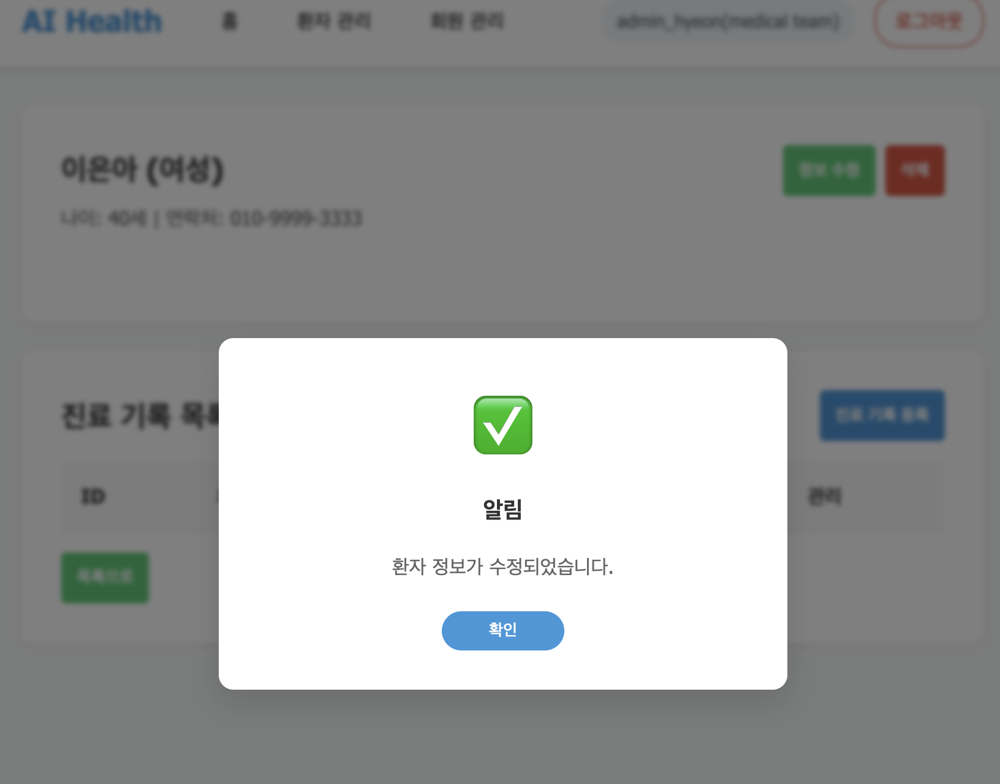


## 8. 진료기록 등록 (담당: 장성은)

- API: `POST /api/v1/medical-records` (의료인만)
- 환자 상세 화면의 "진료 기록 등록" 버튼으로 들어가 차트 번호, 증상, X-ray 이미지를 입력한다.
- 이미지를 고르면 아래 칸에 미리보기가 바로 보인다.
- 파일이 있어서 JSON이 아니라 form-data로 `patient_id`, `chart_number`, `symptoms`, `xray_image`를 함께 보낸다.
- 등록이 끝나면 환자 상세 화면으로 돌아가고, 진료기록 목록에 새 기록이 추가된다.
- 테스트에는 공개 데이터셋(소아 흉부 X-ray) 이미지를 사용했다.


## 9. 진료기록 목록 · 상세 · AI 예측 (담당: 엄태은)

### 9-1. 진료기록 목록

- 화면: 환자 목록 → **상세보기** → 아래쪽 "진료 기록 목록"
- API: `GET /api/v1/patients/{patient_id}/medical-records`
- 표시: ID, 차트 번호, 증상(100자 요약), 등록일, 상세보기 버튼


### 9-2. 진료기록 상세 · AI 예측

- 상세 API: `GET /api/v1/medical-records/{record_id}` → 차트 번호, 증상, 등록일, X-ray 이미지 표시
- AI 예측 API: **AI 예측 결과보기** 버튼 → `POST /api/v1/medical-records/{record_id}/predict`
- 결과 목록 API: `GET /api/v1/medical-records/{record_id}/analyses` → 수행 일시, 폐렴 여부, Confidence, 사용 모델


| 항목 | 값 | 설명 |
|---|---|---|
| 폐렴 여부 | Positive | 폐렴 확률이 기준값(0.5) 이상 → 폐렴으로 판단 (Positive 행은 빨간색 강조) |
| Confidence | 66.16% | 모델이 고른 쪽(폐렴)의 확률 × 100 |
| 사용 모델 | resnet18_e1b | 6일차에 연결한 ResNet18 모델 이름 |

- 재사용 확인: **AI 예측 결과보기**를 다시 눌러도 결과 목록이 1줄 그대로다. 같은 진료기록 + 같은 모델의 결과가 이미 있으면 AI를 다시 돌리지 않고 저장된 결과를 돌려준다(새로 예측하면 201, 재사용이면 200).

→ 의료진은 환자 상세에서 진료기록을 골라 X-ray와 AI 판독 결과를 한 화면에서 확인할 수 있다.
