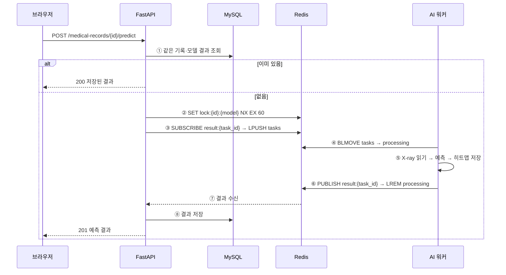

# 9일차 동시성 문제 해결을 위한 아키텍처 설계

> 과제: FastAPI와 Redis 기반 Event-Driven Architecture를 공부하고, AI 추론 작업을 별도 워커로 분리하는 구조를 Excalidraw로 설계한다.
>
> 팀원별 담당
> - 엄태은: 1. 현재 구조와 동시성 문제, 5. 우리 서비스 아키텍처 설계(도식화)
> - 김민준: 2. Event-Driven Architecture 개념
> - 여현지: 3. Redis로 작업 큐 만들기
> - 장성은: 4. Celery와 직접 구현 비교

---

## 1. 현재 구조와 동시성 문제 (담당: 엄태은)

### 1-1. 지금(6일차)의 예측 흐름

```
브라우저 ─ POST /medical-records/{id}/predict ─▶ FastAPI
                                                  ├─ ① DB에 같은 기록·모델 결과가 있으면 그대로 반환
                                                  ├─ ② run_in_threadpool(predict)  ← 같은 프로세스 안에서 AI 추론
                                                  └─ ③ DB 저장 후 201 응답
```

- 6일차에는 모델을 서버 시작 시 한 번만 메모리에 올리고(`lifespan` → `get_model()`), 예측은 `run_in_threadpool`로 별도 스레드에서 돌렸다.
- 로컬 CPU 기준 첫 예측 0.69초, 이후 0.14초로 "3초 이내 응답" 요구사항은 만족했다.

### 1-2. 사용자가 늘어나면 생기는 문제

| 문제 | 원인 | 결과 |
|---|---|---|
| 예측 요청이 한 줄로 밀림 | `worker/model.py`의 `predict()`가 Grad-CAM 훅 때문에 `threading.Lock`으로 한 번에 하나씩만 실행 | 동시에 10명이 누르면 10번째 사람은 앞의 9건이 끝날 때까지 대기 |
| 다른 API까지 느려짐 | AI 추론(CPU를 많이 쓰는 작업)이 웹 서버와 같은 프로세스·같은 CPU를 나눠 씀 | 예측이 몰리면 로그인·환자 목록 같은 가벼운 API 응답도 늦어짐 |
| 서버를 늘리기 어려움 | 웹 서버 프로세스마다 모델(약 45MB + PyTorch)을 따로 메모리에 올림 | `--workers 4`로 늘리면 모델 메모리도 4배 |
| 같은 요청이 동시에 두 번 처리됨 | "DB에 결과가 있나 확인 → 없으면 예측 → 저장"이 한 덩어리가 아님 (Check-then-Act 경쟁 상태) | 두 번 클릭하면 둘 다 "없음"으로 보고 같은 예측을 두 번 실행, 결과 행도 2개 |
| 장애가 번짐 | 모델 오류·메모리 부족이 웹 서버 안에서 일어남 | AI 쪽 문제로 웹 서버 전체가 죽을 수 있음 |

→ 그래서 **"요청을 받는 일(FastAPI)"과 "무거운 계산을 하는 일(AI 워커)"을 다른 컨테이너로 나누고**, 둘 사이를 Redis 작업 큐로 연결한다.

---

## 2. Event-Driven Architecture 개념 (담당: 김민준)

<!--
- Event-Driven Architecture 정의, Producer·Broker·Consumer
- 동기 요청-응답 vs 이벤트 기반 비교
- FastAPI에서 무거운 작업을 미루는 방법 비교 (BackgroundTasks / asyncio.create_task / 작업 큐)
-->

---

## 3. Redis로 작업 큐 만들기 (담당: 여현지)

<!--
- Redis 특징 (메모리 저장, 명령 하나하나가 원자적)
- List 작업 큐 (LPUSH / BRPOP), Reliable Queue (BLMOVE / LREM)
- Pub/Sub (SUBSCRIBE / PUBLISH, 구독 먼저!)
- Streams와 비교
-->

---

## 4. Celery와 직접 구현 비교 (담당: 장성은)

### 4-1. Celery 구조

| 구성 | 역할 | 우리 설계에서 대응 |
|---|---|---|
| Client | 작업을 만들어 브로커로 보냄 | FastAPI |
| Broker | 작업 메시지를 보관 (Redis, RabbitMQ) | Redis `pneumonia:tasks` |
| Worker | 작업을 꺼내 실행, `--concurrency`로 자식 프로세스 수 지정 | AI 워커 |
| Result Backend | 작업 결과 저장 (Redis 등) | Redis Pub/Sub 채널 `pneumonia:result:{task_id}` |
| Beat | 주기적인 작업 예약 | 사용하지 않음 |

- 흐름: `task.delay()` → 브로커에 작업 등록 → 워커가 실행 → 결과 백엔드에 저장 → 클라이언트가 결과 조회
- 재시도(`retry`), 작업 연결(`chain`), 모니터링 도구(Flower) 등 기능이 많다.

### 4-2. 비교

| 구분 | Celery | Redis 직접 구현 |
|---|---|---|
| 구현량 | 적음 (데코레이터로 작업 정의) | 큐·복구·결과 전달을 직접 작성 |
| 기능 | 재시도, 예약, 모니터링 내장 | 필요한 것만 직접 |
| 의존성 | Celery 패키지와 설정 | `redis` 패키지 하나 |
| 동작 이해 | 내부가 감춰져 있음 | 큐·잠금·Pub/Sub 원리를 그대로 확인 |
| 결과 기다리기 | `result.get()`은 기다리는 동안 멈추는 방식이라 비동기 FastAPI에서 쓰려면 따로 처리가 필요 | Pub/Sub 구독으로 비동기로 기다릴 수 있음 |

→ 이번 과제는 **Redis 작업 큐와 Pub/Sub 원리를 직접 다루는 것**이 목표라 직접 구현한다. 작업 종류가 많아지거나 재시도·예약이 필요해지면 Celery 도입을 검토한다.

---

## 5. 우리 서비스 아키텍처 설계 (담당: 엄태은)

### 5-1. 아키텍처 다이어그램


> Excalidraw 원본: [`docs/images/day9/architecture.excalidraw`](images/day9/architecture.excalidraw) (excalidraw.com → 열기에서 불러와 수정 가능)

### 5-2. 구성 요소

| 컨테이너 | 역할 | 하지 않는 일 |
|---|---|---|
| FastAPI (`app/`) | 요청 검증, DB 조회·저장, 작업 등록, 결과 대기 후 응답 | AI 모델 로드·추론 |
| AI 워커 (`worker/`) ×N | 큐에서 작업을 꺼내 폐렴 예측 + Grad-CAM, 결과 발행 | DB 접근, HTTP 요청 처리 |
| Redis | 작업 큐, 처리 중 목록, 중복 잠금, 결과 채널 | 영구 저장 |
| MySQL | 진료기록·X-ray·예측 결과 저장 | — |
| 공유 볼륨 `media/` | X-ray 원본(FastAPI 저장 → 워커 읽기), 히트맵(워커 저장) | — |

### 5-3. 처리 흐름



### 5-4. 주고받는 메시지

작업 (FastAPI → `pneumonia:tasks`)
```json
{"task_id": "uuid", "record_id": 1, "image_path": "media/xray/xxx.png", "ai_model": "resnet18_e1b"}
```

결과 (AI 워커 → `pneumonia:result:{task_id}`)
```json
{"task_id": "uuid", "status": "success", "is_pneumonia": true, "confidence": 66.16, "heatmap_url": "/media/heatmaps/yyy.png", "ai_model": "resnet18_e1b"}
```
- 실패하면 `{"status": "error", "message": "..."}`를 발행하고, FastAPI는 500으로 응답한다.

### 5-5. Redis 키 정리

| 키 | 자료형 | 용도 |
|---|---|---|
| `pneumonia:tasks` | List | 대기 중인 예측 작업 |
| `pneumonia:processing` | List | 워커가 처리 중인 작업 (복구용) |
| `pneumonia:lock:{record_id}:{model}` | String | 같은 기록·모델 동시 요청 잠금 (60초 후 자동 만료) |
| `pneumonia:result:{task_id}` | Pub/Sub 채널 | 작업 결과 전달 |

### 5-6. 동시성 문제를 이렇게 해결한다

| 1번에서 정리한 문제 | 해결 방법 |
|---|---|
| 예측 요청이 한 줄로 밀림 | AI 워커를 여러 개 띄워 병렬 처리 (`docker compose up --scale ai-worker=3`) |
| 다른 API까지 느려짐 | 추론은 워커 컨테이너에서만 실행, FastAPI는 결과를 비동기로 기다리는 동안 다른 요청 처리 |
| 서버를 늘리기 어려움 | 모델은 워커만 로드, FastAPI 이미지에는 PyTorch를 넣지 않아 가볍게 유지 |
| 같은 요청이 동시에 두 번 처리됨 | ① DB에 결과가 있으면 재사용 ② `SET NX` 잠금을 얻은 요청 1건만 큐에 등록, 나머지는 잠시 기다렸다가 저장된 결과를 반환 ③ `BLMOVE`가 원자적이라 한 작업은 한 워커만 처리 |
| 장애가 번짐 | 워커가 죽어도 웹 서버는 정상, 재시작 시 processing 목록의 작업을 tasks로 복구 |

### 5-7. 예외 상황

| 상황 | 처리 |
|---|---|
| 30초 안에 결과가 오지 않음 | 구독 해제, 잠금 해제 후 504 "예측이 지연되고 있습니다." |
| 워커가 예측 중 오류 | `status: error` 발행 → FastAPI 500 응답, 잠금 해제 |
| 워커가 작업 도중 종료 | 작업이 processing에 남아 있음 → 워커 재시작 시 tasks로 되돌려 재처리 |
| FastAPI가 결과를 받기 전에 종료 | 히트맵만 남고 DB에는 저장 안 됨 → 같은 요청을 다시 보내면 새로 예측 (잠금은 만료 시간으로 자동 해제) |

---

## 6. 참고 자료

- [Redis Streams와 FastAPI로 이벤트 처리하기 (OneUptime)](https://oneuptime.com/blog/post/2026-03-31-redis-fastapi-streams-event-processing/view)
- [FastAPI + Celery로 AI Task 비동기 처리하기 (velog)](https://velog.io/@nickygod/FastAPI-Celery로-AI-Task-비동기-처리하기)
- [Mastering Background Job Queues with Celery, Redis and FastAPI](https://python.plainenglish.io/mastering-background-job-queues-with-celery-redis-and-fastapi-9eabb97c38af)
- [Redis 공식 문서 — BLMOVE (Reliable queue 패턴)](https://redis.io/docs/latest/commands/blmove/)
- [Redis 공식 문서 — Pub/Sub](https://redis.io/docs/latest/develop/interact/pubsub/)
