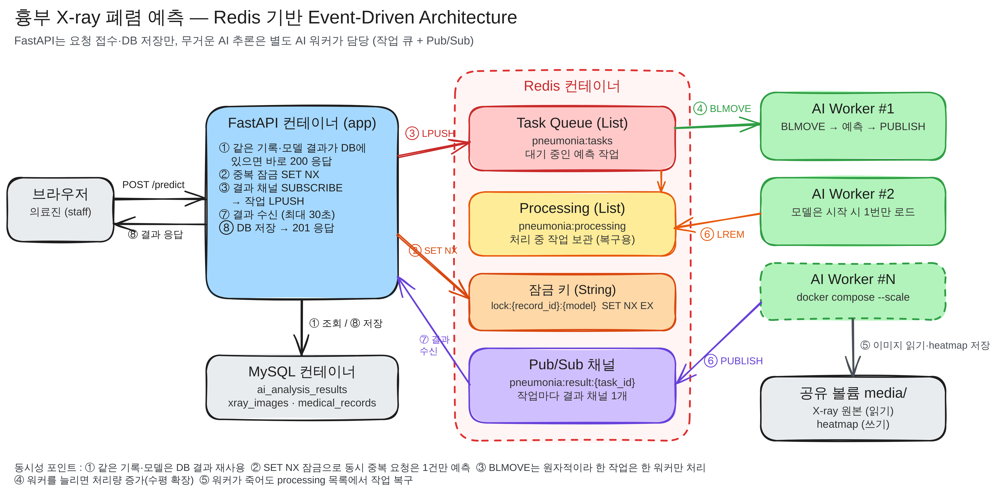
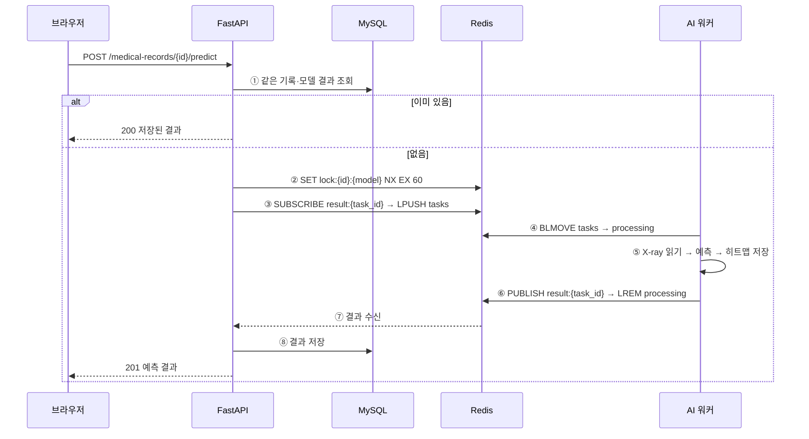

# 9일차 동시성 문제 해결을 위한 아키텍처 설계

> 과제: FastAPI와 Redis 기반 Event-Driven Architecture를 공부하고, AI 추론 작업을 별도 워커로 분리하는 구조를 Excalidraw로 설계한다.
>
> 팀원별 담당
> - 엄태은: 1. 현재 구조와 동시성 문제, 5. 우리 서비스 아키텍처 설계(도식화)
> - 김민준: 2. Event-Driven Architecture 개념
> - 여현지: 3. Redis로 작업 큐 만들기
> - 장성은: 4. Celery와 직접 구현 비교

---

## 1. 현재 구조와 동시성 문제 (담당: 엄태은)

### 1-1. 지금(6일차)의 예측 흐름

```
브라우저 ─ POST /medical-records/{id}/predict ─▶ FastAPI
                                                  ├─ ① DB에 같은 기록·모델 결과가 있으면 그대로 반환
                                                  ├─ ② run_in_threadpool(predict)  ← 같은 프로세스 안에서 AI 추론
                                                  └─ ③ DB 저장 후 201 응답
```

- 6일차에는 모델을 서버 시작 시 한 번만 메모리에 올리고(`lifespan` → `get_model()`), 예측은 `run_in_threadpool`로 별도 스레드에서 돌렸다.
- 로컬 CPU 기준 첫 예측 0.69초, 이후 0.14초로 "3초 이내 응답" 요구사항은 만족했다.

### 1-2. 사용자가 늘어나면 생기는 문제

| 문제 | 원인 | 결과 |
|---|---|---|
| 예측 요청이 한 줄로 밀림 | `worker/model.py`의 `predict()`가 Grad-CAM 훅 때문에 `threading.Lock`으로 한 번에 하나씩만 실행 | 동시에 10명이 누르면 10번째 사람은 앞의 9건이 끝날 때까지 대기 |
| 다른 API까지 느려짐 | AI 추론(CPU를 많이 쓰는 작업)이 웹 서버와 같은 프로세스·같은 CPU를 나눠 씀 | 예측이 몰리면 로그인·환자 목록 같은 가벼운 API 응답도 늦어짐 |
| 서버를 늘리기 어려움 | 웹 서버 프로세스마다 모델(약 45MB + PyTorch)을 따로 메모리에 올림 | `--workers 4`로 늘리면 모델 메모리도 4배 |
| 같은 요청이 동시에 두 번 처리됨 | "DB에 결과가 있나 확인 → 없으면 예측 → 저장"이 한 덩어리가 아님 (Check-then-Act 경쟁 상태) | 두 번 클릭하면 둘 다 "없음"으로 보고 같은 예측을 두 번 실행, 결과 행도 2개 |
| 장애가 번짐 | 모델 오류·메모리 부족이 웹 서버 안에서 일어남 | AI 쪽 문제로 웹 서버 전체가 죽을 수 있음 |

→ 그래서 **"요청을 받는 일(FastAPI)"과 "무거운 계산을 하는 일(AI 워커)"을 다른 컨테이너로 나누고**, 둘 사이를 Redis 작업 큐로 연결한다.

---

## 2. Event-Driven Architecture 개념 (담당: 김민준)


### 2.1 Event-Driven Architecture(EDA)란?

Event-Driven Architecture(이벤트 기반 아키텍처)는 시스템에서 발생하는 이벤트를 중심으로 여러 구성 요소가 통신하고 작업을 처리하는 설계 방식이다.

이벤트(Event)는 시스템에서 발생한 사건을 의미한다. 예를 들어 AI 분석이 완료되었다는 사실을 이벤트로 표현할 수 있다.

기존에는 API 서버가 모든 작업을 직접 처리했다면, 이벤트 기반 구조에서는 작업을 요청하는 부분과 실제 처리하는 부분을 분리할 수 있다.

우리 프로젝트에서는 FastAPI가 폐렴 AI 분석 요청을 받아 Redis 작업 큐에 등록하고, 별도의 AI Worker가 추론 작업을 처리하는 구조를 고려한다.

단, 작업을 실행하라는 요청은 엄밀히 말하면 이벤트가 아닌 명령(Command)이다. 이번 설계는 EDA의 구성 요소 분리 개념을 비동기 작업 큐에 적용한 형태이다.

#### EDA의 주요 구성 요소

**1. Producer (생산자)**
- 메시지를 생성하고 전달하는 구성 요소이다.
- 우리 프로젝트에서는 FastAPI가 해당 역할을 수행한다.
- 사용자의 AI 분석 요청을 받아 작업 메시지를 생성한다.

**2. Broker (중개자)**
- Producer와 Consumer 사이에서 메시지를 전달하는 역할이다.
- 우리 프로젝트에서는 Redis를 활용한다.
- 작업을 큐에 저장하고 Worker가 가져갈 수 있도록 한다.

**3. Consumer (소비자)**
- 메시지를 전달받아 실제 작업을 수행하는 구성 요소이다.
- 우리 프로젝트에서는 AI Worker가 해당 역할을 수행한다.
- Redis에서 작업을 가져와 폐렴 예측 모델을 실행하고 결과를 DB에 저장한다.

전체 흐름은 다음과 같다.

사용자 → FastAPI(Producer) → Redis(Broker) → AI Worker(Consumer) → DB

---

### 2.2 동기 요청-응답 방식과 이벤트 기반 방식 비교

#### 1. 동기 요청-응답 방식

동기 방식에서는 클라이언트가 요청을 보내면 서버가 모든 작업을 처리한 뒤 결과를 반환한다.

예를 들어 폐렴 AI 분석 요청이 들어오면 다음과 같이 동작한다.

사용자 → FastAPI → AI 모델 추론 → DB 저장 → 결과 응답

이 방식은 구조가 단순하지만 AI 추론 시간이 길어지면 응답이 지연된다.

또한 동시에 여러 요청이 들어오면 CPU, GPU 등의 자원 경합으로 처리 속도가 느려질 수 있다.

#### 2. 이벤트 기반 비동기 작업 처리 방식

비동기 작업 큐 방식에서는 FastAPI가 분석 요청을 Redis에 등록하고 작업 접수 응답을 먼저 반환한다.

실제 AI 추론은 별도로 실행 중인 Worker가 담당한다.

사용자 → FastAPI → Redis 작업 큐 → AI Worker → DB 저장

사용자는 작업 ID를 이용하여 이후 분석 상태와 결과를 조회한다.

이 방식에서는 요청 접수와 AI 추론을 분리할 수 있어 API 서버의 응답성을 개선할 수 있다.

#### 비교

| 구분 | 동기 요청-응답 | 비동기 작업 큐 |
|---|---|---|
| API 응답 | 추론 완료 후 | 작업 접수 후 |
| AI 추론 | 요청 처리 과정에서 실행 | 별도 Worker 실행 |
| 작업 관리 | 요청 중심 | 큐 및 작업 상태 중심 |
| 확장성 | API와 추론이 결합됨 | Worker 독립 확장 가능 |
| 장애 대응 | 요청 실패 처리 | 재시도 및 복구 설계 필요 |

비동기 작업 큐를 사용하더라도 AI 추론 자체가 빨라지는 것은 아니다. Worker 수, 큐 적체, 중복 처리 등의 문제는 별도로 관리해야 한다.

---

### 2.3 FastAPI에서 무거운 작업을 미루는 방법 비교

FastAPI에서 시간이 오래 걸리는 작업을 요청 처리 과정에서 분리하는 방법에는 BackgroundTasks, asyncio.create_task(), 외부 작업 큐 방식 등이 있다.

#### 1. BackgroundTasks

FastAPI에서 제공하는 기능으로, 응답을 반환한 뒤 같은 서버 프로세스에서 작업을 실행할 수 있다.

**장점**
- 구현이 간단하다.
- 별도의 Redis나 Worker가 필요하지 않다.
- 로그 기록, 간단한 알림 전송 등에 활용하기 좋다.

**단점**
- API 서버 프로세스와 작업 실행이 분리되지 않는다.
- CPU나 GPU를 많이 사용하는 작업은 서버 성능에 영향을 줄 수 있다.
- 서버가 종료되면 미완료 작업이 유실될 수 있다.

따라서 무거운 AI 모델 추론을 안정적으로 처리하기 위한 방법으로는 한계가 있다.

#### 2. asyncio.create_task()

Python의 asyncio 기능으로, 코루틴을 현재 이벤트 루프에서 별도의 Task로 실행하도록 예약한다.

**장점**
- 비동기 작업을 동시에 진행하도록 구성할 수 있다.
- 외부 큐 없이 비동기 I/O 작업을 실행할 수 있다.

**단점**
- 같은 이벤트 루프에서 실행되므로 CPU 연산을 자동으로 병렬 처리하지 않는다.
- 오래 걸리는 동기 연산은 이벤트 루프를 차단할 수 있다.
- 작업 상태 추적과 오류 처리 및 종료 시 정리를 직접 구현해야 한다.
- 서버 재시작 시 작업의 지속성이 보장되지 않는다.

따라서 장시간 수행되는 AI 추론 작업을 독립적으로 관리하기에는 적합하지 않을 수 있다.

#### 3. Redis 작업 큐 + AI Worker

FastAPI가 Redis에 작업을 등록하고, 별도의 Worker 프로세스가 해당 작업을 수행하는 방식이다.

**장점**
- API 서버와 AI 추론 실행 환경을 분리할 수 있다.
- 요청량이 증가하면 작업을 큐에 대기시킬 수 있다.
- Worker 수를 독립적으로 조절할 수 있다.
- 작업 상태 관리 및 재시도 구조를 설계할 수 있다.

**단점**
- Redis와 Worker를 별도로 운영해야 한다.
- 메시지 유실 및 중복 실행에 대비해야 한다.
- 작업 큐와 DB 사이의 상태 일관성을 관리해야 한다.
- Redis를 사용한다는 사실만으로 작업의 영속성이나 재시도가 자동 보장되지는 않는다.

#### 세 가지 방식 비교

| 항목 | BackgroundTasks | asyncio.create_task() | Redis + Worker |
|---|---|---|---|
| 실행 위치 | API 서버 프로세스 | 현재 이벤트 루프 | 별도 Worker |
| 구현 난이도 | 낮음 | 낮음~중간 | 중간~높음 |
| 별도 큐 필요 | 없음 | 없음 | 필요 |
| 서버 종료 시 작업 보존 | 보장 안 됨 | 보장 안 됨 | 별도 복구 설계 가능 |
| 무거운 AI 추론 | 부적합할 수 있음 | 부적합할 수 있음 | 상대적으로 적합 |

### 2.4 우리 프로젝트에 적합한 방식

우리 프로젝트는 흉부 X-ray 이미지에 대한 폐렴 AI 예측 서비스를 개발하고 있다.

AI 모델 추론은 일반적인 API 요청보다 처리 시간이 길고 CPU, GPU 등의 연산 자원을 사용할 수 있다.

따라서 FastAPI 내부에서 추론을 직접 실행하는 방식보다 **Redis 작업 큐와 별도 AI Worker를 사용하는 방식**이 서비스 확장과 작업 관리 측면에서 적합하다.

이를 통해 다음과 같은 구조를 설계할 수 있다.

1. 사용자가 폐렴 AI 분석을 요청한다.
2. FastAPI가 요청을 검증하고 Redis 큐에 작업을 등록한다.
3. FastAPI는 작업 ID와 접수 결과를 반환한다.
4. AI Worker가 큐에서 작업을 가져와 모델 추론을 수행한다.
5. 분석 결과와 작업 상태를 DB에 저장한다.
6. 사용자가 별도 API로 분석 결과를 확인한다.

이 구조는 다음 Stage 3에서 Redis 작업 큐와 AI Worker 분리 구현을 진행하기 위한 기초 설계가 된다.


---

## 3. Redis로 작업 큐 만들기 (담당: 여현지)

<!--
- Redis 특징 (메모리 저장, 명령 하나하나가 원자적)
- List 작업 큐 (LPUSH / BRPOP), Reliable Queue (BLMOVE / LREM)
- Pub/Sub (SUBSCRIBE / PUBLISH, 구독 먼저!)
- Streams와 비교
-->

---

## 4. Celery와 직접 구현 비교 (담당: 장성은)

<!--
- Celery 구성 (Client, Broker, Worker, Result Backend, Beat)
- Celery vs Redis 직접 구현 비교, 우리가 직접 구현하는 이유
-->

---

## 5. 우리 서비스 아키텍처 설계 (담당: 엄태은)

### 5-1. 아키텍처 다이어그램



> Excalidraw 원본: [`docs/images/day9/architecture.excalidraw`](images/day9/architecture.excalidraw) (excalidraw.com → 열기에서 불러와 수정 가능)

### 5-2. 구성 요소

| 컨테이너 | 역할 | 하지 않는 일 |
|---|---|---|
| FastAPI (`app/`) | 요청 검증, DB 조회·저장, 작업 등록, 결과 대기 후 응답 | AI 모델 로드·추론 |
| AI 워커 (`worker/`) ×N | 큐에서 작업을 꺼내 폐렴 예측 + Grad-CAM, 결과 발행 | DB 접근, HTTP 요청 처리 |
| Redis | 작업 큐, 처리 중 목록, 중복 잠금, 결과 채널 | 영구 저장 |
| MySQL | 진료기록·X-ray·예측 결과 저장 | — |
| 공유 볼륨 `media/` | X-ray 원본(FastAPI 저장 → 워커 읽기), 히트맵(워커 저장) | — |

### 5-3. 처리 흐름



### 5-4. 주고받는 메시지

작업 (FastAPI → `pneumonia:tasks`)
```json
{"task_id": "uuid", "record_id": 1, "image_path": "media/xray/xxx.png", "ai_model": "resnet18_e1b"}
```

결과 (AI 워커 → `pneumonia:result:{task_id}`)
```json
{"task_id": "uuid", "status": "success", "is_pneumonia": true, "confidence": 66.16, "heatmap_url": "/media/heatmaps/yyy.png", "ai_model": "resnet18_e1b"}
```
- 실패하면 `{"status": "error", "message": "..."}`를 발행하고, FastAPI는 500으로 응답한다.

### 5-5. Redis 키 정리

| 키 | 자료형 | 용도 |
|---|---|---|
| `pneumonia:tasks` | List | 대기 중인 예측 작업 |
| `pneumonia:processing` | List | 워커가 처리 중인 작업 (복구용) |
| `pneumonia:lock:{record_id}:{model}` | String | 같은 기록·모델 동시 요청 잠금 (60초 후 자동 만료) |
| `pneumonia:result:{task_id}` | Pub/Sub 채널 | 작업 결과 전달 |

### 5-6. 동시성 문제를 이렇게 해결한다

| 1번에서 정리한 문제 | 해결 방법 |
|---|---|
| 예측 요청이 한 줄로 밀림 | AI 워커를 여러 개 띄워 병렬 처리 (`docker compose up --scale ai-worker=3`) |
| 다른 API까지 느려짐 | 추론은 워커 컨테이너에서만 실행, FastAPI는 결과를 비동기로 기다리는 동안 다른 요청 처리 |
| 서버를 늘리기 어려움 | 모델은 워커만 로드, FastAPI 이미지에는 PyTorch를 넣지 않아 가볍게 유지 |
| 같은 요청이 동시에 두 번 처리됨 | ① DB에 결과가 있으면 재사용 ② `SET NX` 잠금을 얻은 요청 1건만 큐에 등록, 나머지는 잠시 기다렸다가 저장된 결과를 반환 ③ `BLMOVE`가 원자적이라 한 작업은 한 워커만 처리 |
| 장애가 번짐 | 워커가 죽어도 웹 서버는 정상, 재시작 시 processing 목록의 작업을 tasks로 복구 |

### 5-7. 예외 상황

| 상황 | 처리 |
|---|---|
| 30초 안에 결과가 오지 않음 | 구독 해제, 잠금 해제 후 504 "예측이 지연되고 있습니다." |
| 워커가 예측 중 오류 | `status: error` 발행 → FastAPI 500 응답, 잠금 해제 |
| 워커가 작업 도중 종료 | 작업이 processing에 남아 있음 → 워커 재시작 시 tasks로 되돌려 재처리 |
| FastAPI가 결과를 받기 전에 종료 | 히트맵만 남고 DB에는 저장 안 됨 → 같은 요청을 다시 보내면 새로 예측 (잠금은 만료 시간으로 자동 해제) |

---

## 6. 참고 자료

- [Redis Streams와 FastAPI로 이벤트 처리하기 (OneUptime)](https://oneuptime.com/blog/post/2026-03-31-redis-fastapi-streams-event-processing/view)
- [FastAPI + Celery로 AI Task 비동기 처리하기 (velog)](https://velog.io/@nickygod/FastAPI-Celery로-AI-Task-비동기-처리하기)
- [Mastering Background Job Queues with Celery, Redis and FastAPI](https://python.plainenglish.io/mastering-background-job-queues-with-celery-redis-and-fastapi-9eabb97c38af)
- [Redis 공식 문서 — BLMOVE (Reliable queue 패턴)](https://redis.io/docs/latest/commands/blmove/)
- [Redis 공식 문서 — Pub/Sub](https://redis.io/docs/latest/develop/interact/pubsub/)
